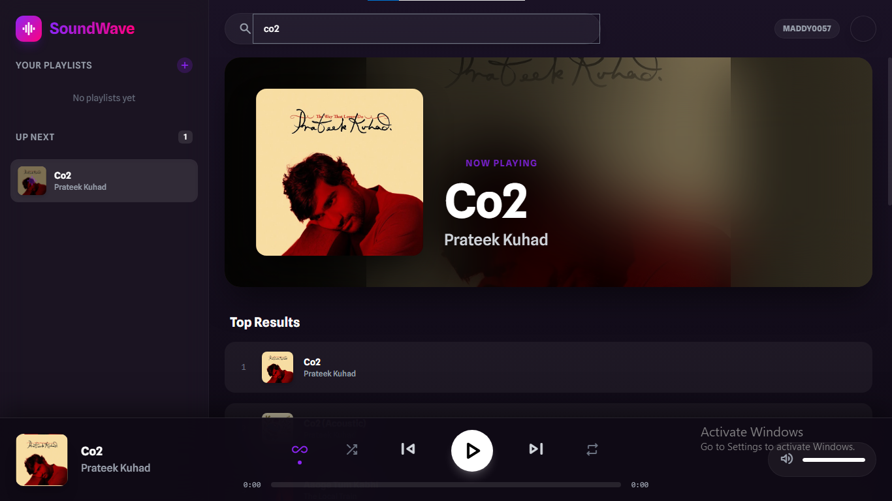
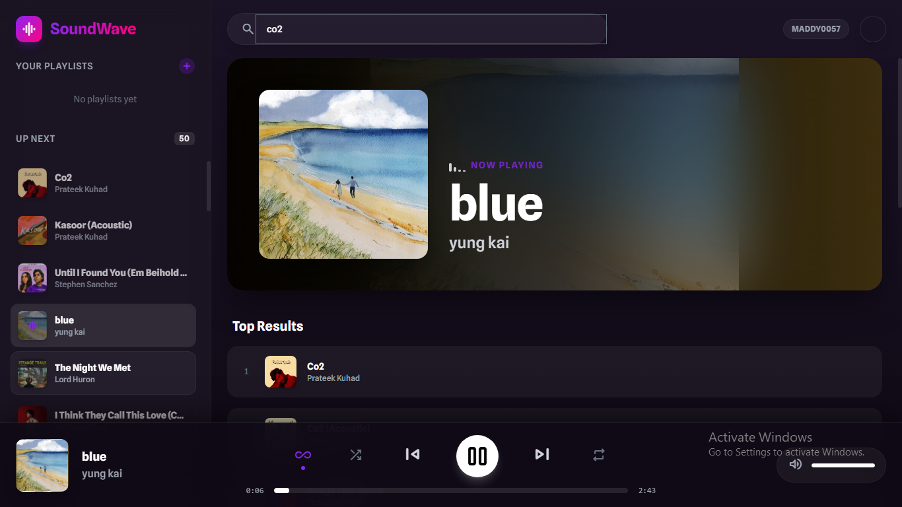

<div align="center">

# 🎵 **SoundWave Premium v2.0**
### **The Ultimate Open-Source Music Experience**


<br />

> **"Stop renting your music. Start owning the vibe."**
>
> A stunning, self-hosted Python Music Player and Flask Web App that streams **High-Fidelity Audio** directly from YouTube Music — **Ad-Free Streaming. Zero Tracking. Infinite Play. Real-Time Lyrics.**

[**View Demo**](#) · [**Report Bug**](https://github.com/Maddy0057/SoundWave/issues) · [**Request Feature**](https://github.com/Maddy0057/SoundWave/issues)

</div>

---

## 📥 **Download SoundWave v2.0**

Get the latest Windows standalone build directly. Pre-bundled, zero setup required!

<div align="center">

[](https://github.com/Maddy0057/SoundWave/releases/download/v2.0.0/SoundWave.zip)

</div>

**Requirements:** Windows 10 or 11 (64-bit).

---

## 🔥 **What's New in v2.0?**

- **🎤 Multi-Tier Synced & Plain Lyrics Engine**
  - Instant synchronized lyrics powered by **LRCLIB + YouTube Music (Musixmatch) + Genius**.
  - Full native support for **Telugu, Hindi, Tamil, Kannada, Malayalam, and English** with beautiful Indic script typography and click-to-seek line synchronization.
- **📂 Full-Featured Playlist System**
  - Create, view, rename, and delete custom playlists.
  - Add songs from Search results, Trending shelves, or directly from the Now-Playing bar.
  - Dedicated playlist detail view with **Play All**, **Shuffle Play**, and per-track removal.
  - Keyboard shortcuts (**Enter** to confirm, **Escape** to dismiss) and toast notifications.
- **🔁 3-Mode Gapless Repeat**
  - **Repeat Off**, **Repeat All (Queue)**, and **Repeat One (Single Track)**.
  - Hardware-accelerated gapless HTML5 looping without network buffering, plus smart manual skip.
- **🔥 Dynamic Trending Hub**
  - Multi-category horizontal shelves (India Trending, Tollywood, Bollywood, Kollywood, International).
  - Smooth carousel navigation with interactive left/right scroll controls.
- **🎨 Obsidian Glassmorphism UI**
  - Deep dark mode with glassmorphic cards, glowing accents, blur backdrops, and responsive layouts.

---

## 🛠️ **Tech Stack**

- **Backend:** Python 3, Flask, Waitress (WSGI), ytmusicapi
- **Streaming:** yt-dlp (FFmpeg audio pipeline), subprocess
- **Frontend:** HTML5, Vanilla JavaScript (ES6+), TailwindCSS (CDN), Google Fonts & Material Symbols
- **Lyrics Providers:** LRCLIB (LRC synced), YouTube Music internal Innertube API, Genius scraper
- **Packager:** PyInstaller (`SoundWave.spec`, standalone single-file binary)

---

## ⚡ **Quick Start (Developer Mode)**

Go from zero to streaming in **30 seconds**.

### **Prerequisites**
- Python 3.8 or higher

### **1. Clone the Repository**
```bash
git clone https://github.com/Maddy0057/SoundWave.git
cd SoundWave
```

### **2. Install Dependencies**
```bash
# Windows
python -m venv .venv
.venv\Scripts\activate

# Install requirements
pip install -r requirements.txt
```

### **3. Launch the App 🚀**
```bash
python main.py
```
Waitress starts and automatically opens your default browser at `http://127.0.0.1:5000` (and binds to `0.0.0.0:5000` for local Wi-Fi playback).

---

## 📸 **Screenshots**

<div align="center">


<br />


</div>

---

## 📂 **Project Structure**

```
SoundWave/
├── main.py              # Flask backend, streaming & multi-tier lyrics engine
├── templates/
│   └── index.html       # Modern Glassmorphic UI with Synced Lyrics & Playlists
├── requirements.txt     # Python dependencies
├── playlists.json       # Persistent local playlist storage
├── SoundWave.spec       # Optimized PyInstaller spec file
├── build.bat            # One-click Windows build script
├── logo.ico             # App icon
├── assets/              # UI Screenshots
├── .gitignore
└── README.md            # Project documentation
```

---

## 🧩 **API Endpoints**

| Endpoint | Method | Purpose |
|---|---|---|
| `/` | `GET` | Serves the single-page Glassmorphism web application |
| `/api/search?query=...` | `GET` | Searches YouTube Music for songs and artists |
| `/api/recommendations?videoId=...` | `GET` | Fetches 20+ similar songs for seamless infinite autoplay |
| `/stream/<videoId>` | `GET` | Resolves and redirects to direct high-fidelity audio stream |
| `/api/lyrics?title=...&artist=...&videoId=...` | `GET` | Multi-tier synced (LRC) and plain lyrics provider |
| `/api/trending?category=...` | `GET` | Trending category shelves (India, Tollywood, Bollywood, etc.) |
| `/api/playlists` | `GET` | Lists all saved local playlists |
| `/api/playlists` | `POST` | Creates a new playlist |
| `/api/playlists/<name>` | `DELETE` | Deletes a playlist |
| `/api/playlists/<name>` | `PUT` | Renames an existing playlist |
| `/api/playlists/<name>/songs` | `POST` | Adds a song to a playlist |
| `/api/playlists/<name>/songs/<videoId>` | `DELETE` | Removes a song from a playlist |

---

## 🏁 **Build the Standalone Windows .EXE**

To compile your own single-file executable:

```bash
# Simply run the build script:
build.bat

# Or run PyInstaller manually:
pyinstaller SoundWave.spec --clean --noconfirm
```
The output executable will be placed in `dist/SoundWave.exe`.

---

## 🤝 **Contributing**

Contributions, issues, and feature requests are welcome! Feel free to check the [issues page](https://github.com/Maddy0057/SoundWave/issues).

---

## 📜 **License**

Distributed under the MIT License. See `LICENSE` for more information.

<div align="center">

Love the project? **Give it a ⭐ Star on GitHub!**

Made with ❤️ by [Maddy0057](https://github.com/Maddy0057).

</div>
